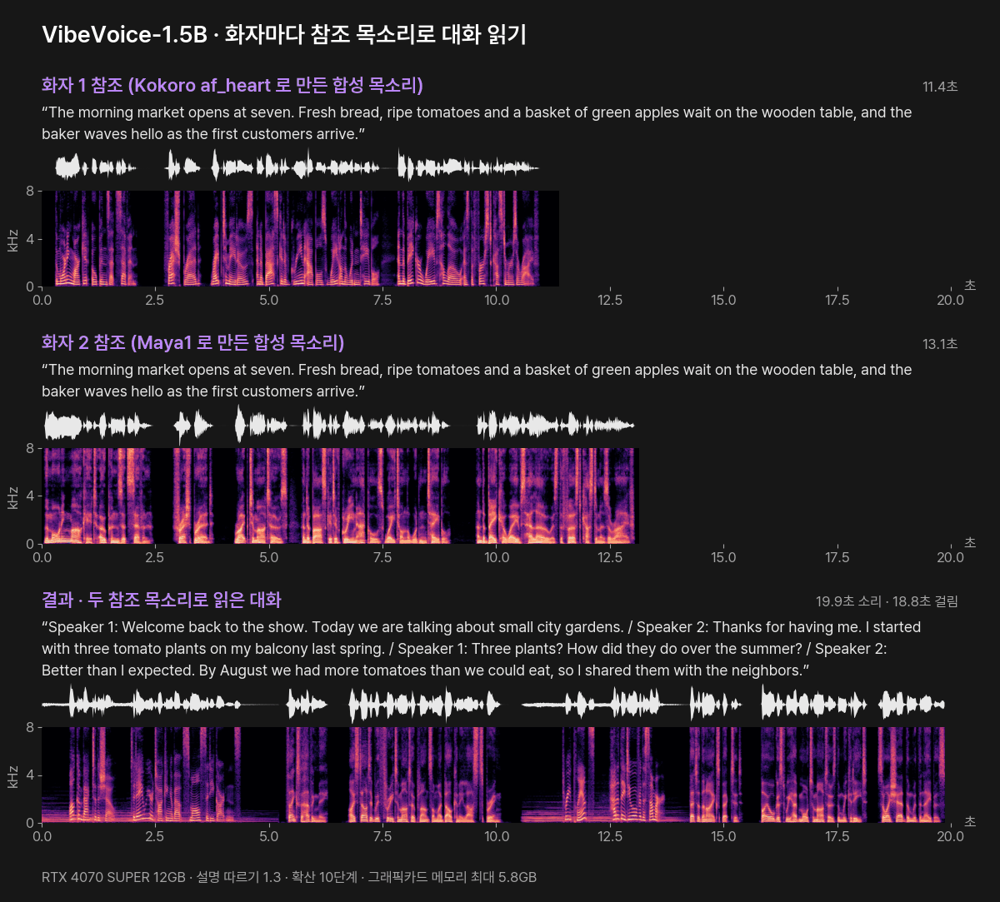
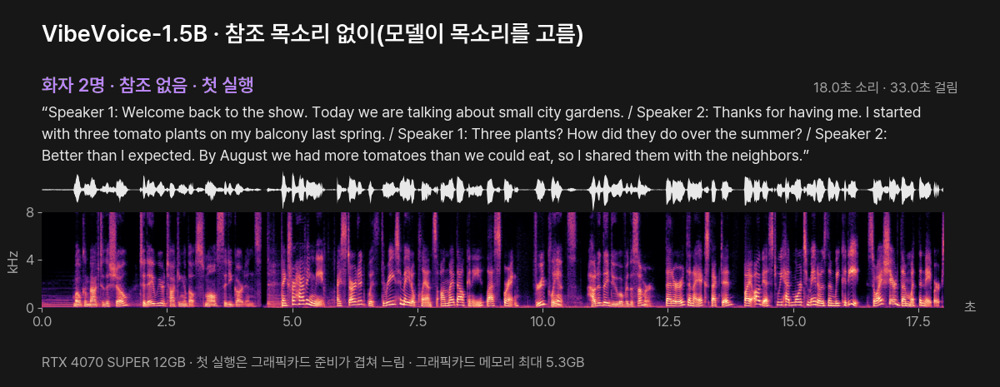
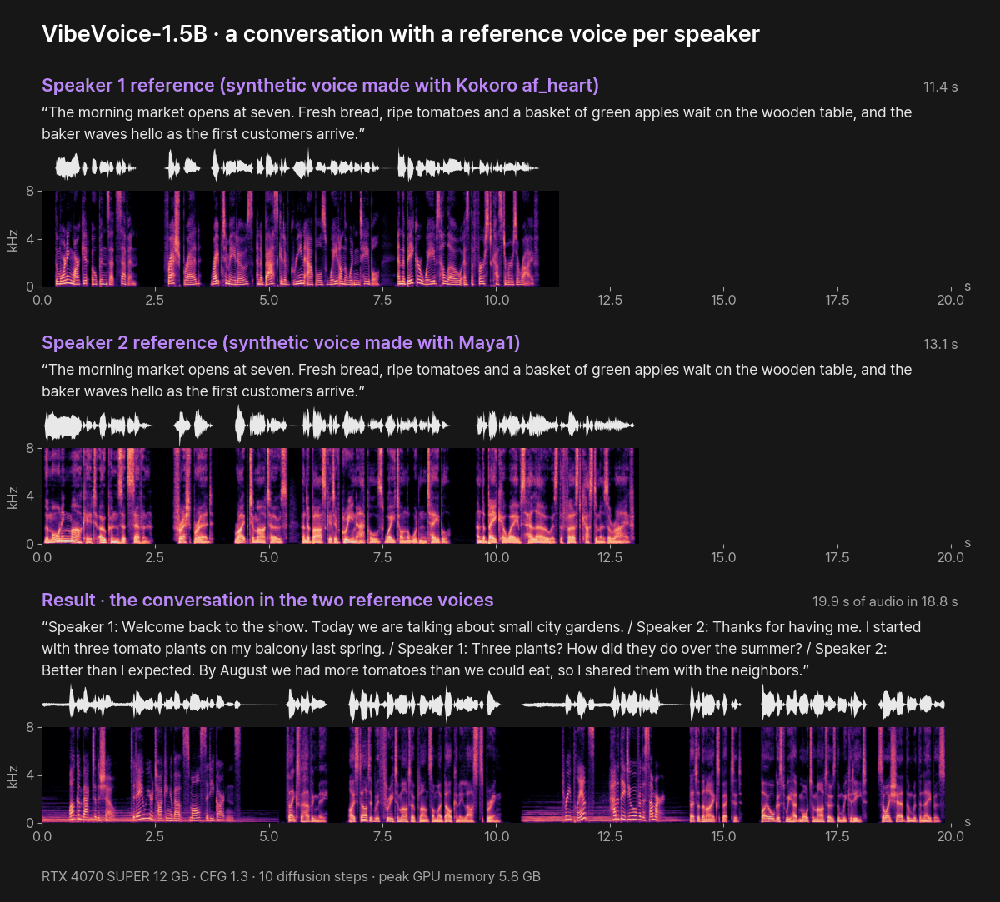
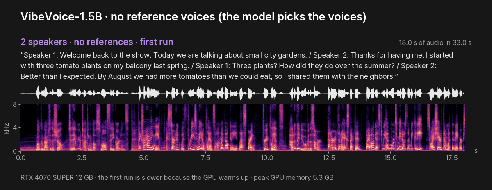

# VibeVoice-1.5B — 최대 4명 긴 대화 목소리 (PromBoard 플러그인)

[English](#english)

대본을 읽어 최대 4명이 주고받는 대화 목소리(WAV)를 만드는 PromBoard 커뮤니티 플러그인입니다. Microsoft 의 오픈 모델 [VibeVoice-1.5B](https://huggingface.co/microsoft/VibeVoice-1.5B)를 이 PC 에서 돌립니다. 팟캐스트 · 오디오북처럼 화자가 번갈아 말하는 긴 글에 맞고, 화자마다 참조 목소리(3~10초 말소리)를 이으면 그 목소리로 읽습니다.



위 두 줄은 화자 1 · 2 에 이은 참조 목소리(다른 플러그인 Kokoro · Maya1 로 만든 합성 목소리), 맨 아래는 두 사람의 대본을 한 번에 읽힌 결과입니다. 각 소리의 위 띠는 파형, 아래 띠는 스펙트로그램(가로 = 시간, 세로 = 소리 높낮이, 밝을수록 큰 소리)입니다. 듣기: [화자 1 참조](docs/ko/audio/reference-speaker1.mp3?raw=true) · [화자 2 참조](docs/ko/audio/reference-speaker2.mp3?raw=true) · [결과](docs/ko/audio/podcast-clone.mp3?raw=true)

- 플러그인 id: `promboard.vibevoice`
- 필요한 앱: PromBoard 1.0.3 이상
- 지원 언어: 영어 · 중국어. **한국어는 없습니다**(공식 카드 「Out-of-scope uses」).
- 라이선스: 플러그인 코드 Apache-2.0. 모델은 MIT 이지만 공식 카드가 **연구 목적 사용으로 한정**합니다(아래 「라이선스와 조건」)

## 어떤 경로로 돌리나

Microsoft 는 GitHub 의 VibeVoice-TTS 추론 코드를 2025-09-05 지웠습니다. 이 플러그인은 지금 남은 공식 경로인 transformers 5.x 의 `VibeVoiceForConditionalGeneration` 을 씁니다. transformers 문서의 예제가 쓰는 변환본(`vibevoice/VibeVoice-1.5B-hf`)은 Microsoft 가 아닌 커뮤니티 조직이 올린 것이라 받지 않고, **Microsoft 공식 가중치를 받아 처음 실행할 때 한 번 transformers 형식으로 바꿔 둡니다**. 바꾸는 규칙은 transformers 의 공식 변환 스크립트(`convert_vibevoice_to_hf.py`)를 그대로 옮겼습니다.

## 받는 것과 용량

| 무엇 | 출처 | 크기 | 라이선스 |
|---|---|---|---|
| VibeVoice-1.5B 공식 가중치 | [microsoft/VibeVoice-1.5B](https://huggingface.co/microsoft/VibeVoice-1.5B) | 5.41GB | MIT |
| 글 토크나이저(Qwen2.5-1.5B 의 토크나이저 파일만) | [Qwen/Qwen2.5-1.5B](https://huggingface.co/Qwen/Qwen2.5-1.5B) | 11MB | Apache-2.0 |
| transformers 형식으로 바꾼 가중치(처음 실행 때 로컬 AI 모델 폴더의 플러그인 캐시에 씀) | 위 가중치에서 | 약 5.4GB | MIT |
| 파이썬 패키지(PyTorch 2.8 · transformers · diffusers 등) | PyPI · PyTorch | 약 3GB(다른 플러그인과 같은 PyTorch 는 다시 받지 않습니다) | 각 패키지 |

## 필요한 그래픽카드 메모리

실측 최대 5.8GB(참조 목소리 2개, 파이토치가 잡은 양)입니다. 참조가 없으면 5.3GB 였습니다. 플러그인 최소 요구는 8GB 로 적었습니다(긴 대본은 문맥이 길어져 더 씁니다). CPU 로는 돌리지 않습니다.

## 쓰는 법

노드 추가 목록에서 「VibeVoice 대화 목소리」를 놓고 글 노드를 '대본'에 이은 뒤 ▷ 를 누릅니다. 대본은 줄마다 화자를 적습니다.

```
Speaker 1: Welcome back to the show. Today we are talking about city gardens.
Speaker 2: Thanks for having me. I started with three tomato plants on my balcony.
```

- 화자는 1~4. `1: 글` 처럼 줄여 써도 됩니다. 화자 표시가 없는 줄은 앞 화자가 이어 읽습니다.
- '화자 N 참조 목소리'에 3~10초 말소리를 이으면 그 화자를 그 목소리로 읽습니다(1분까지, wav · mp3 · flac · ogg · m4a). 잇지 않은 화자는 모델이 목소리를 고릅니다.
- 한 번에 6,000자(약 7분 분량)까지 받습니다. 앱이 노드 한 번에 주는 시간(만들기 15분) 안에 끝나게 정했습니다. 더 긴 대본은 나눠서 이어 주세요.

| 설정 | 기본 | 뜻 |
|---|---|---|
| 설명 따르기 (CFG) | 1.3 | 클수록 대본 · 참조 목소리를 더 강하게 따릅니다(1~3) |
| 확산 단계 | 10 | 소리 조각마다 확산 단계 수. 많을수록 느립니다(5~50) |
| 시드 | 42 | 같은 시드 · 같은 입력이면 같은 결과가 나옵니다 |

기본값은 transformers 변환 스크립트가 1.5B 에 정한 값입니다. transformers 구현은 샘플링 없이 늘 가장 높은 확률을 고릅니다.

## 실측

PromBoard 앱에서 실제로 돌려 쟀습니다(앱 1.0.3-beta 의 실행 경로 그대로, RTX 4070 SUPER 12GB · i7-14700K · Windows 11). 만든 소리를 Whisper large-v3-turbo 로 다시 받아써 원문과 비교했습니다.



| 경우 | 대본 | 만든 소리 | 걸린 시간 | 그래픽카드 메모리 최대 | 받아쓰기 비교 | 듣기 |
|---|---|---|---|---|---|---|
| 화자 2명 · 참조 없음 (첫 실행) | 4줄 · 358자 | 18.0초 | 33.0초 | 5.3GB | 대본과 같음 | [듣기](docs/ko/audio/podcast-auto.mp3?raw=true) |
| 화자 2명 · 참조 목소리 2개 | 4줄 · 358자 | 19.9초 | 18.8초 | 5.8GB | 대본과 같음 | [듣기](docs/ko/audio/podcast-clone.mp3?raw=true) |

- 처음 실행할 때 공식 가중치를 transformers 형식으로 바꿔 쓰느라 모델 올리기가 이 PC 의 느린 하드디스크에서 9분 32초 걸렸습니다(한 번만, SSD 면 훨씬 짧습니다). 그다음부터 모델 올리기는 4초 안팎이었습니다.
- 공식 카드가 말한 AI 안내 음성은 결과에 들어가지 않았습니다(받아쓰기에 대본 밖의 말이 없음). 아래 「라이선스와 조건」.

## 라이선스와 조건

- 모델: MIT. 다만 공식 카드 「Responsible Usage」는 **연구 목적 사용으로 한정**하고, 더 시험하지 않은 채 상업 · 실서비스에 쓰는 것을 권하지 않습니다. 동의 없는 목소리 복제 · 사칭, 실제 녹음처럼 꾸민 허위 정보, 실시간 음성 변조, 영어 · 중국어 밖의 언어는 쓰임새 밖입니다.
- 공식 카드는 만든 소리마다 AI 안내 음성("This segment was generated by AI" 같은)과 들리지 않는 워터마크를 넣었다고 적지만, 이 플러그인이 쓰는 transformers 구현에는 그 기능이 없어 **결과에 들어가지 않습니다**. 소리를 공개할 때는 AI 로 만든 소리임을 직접 밝혀 주세요.
- 글 토크나이저(Qwen2.5-1.5B): Apache-2.0.
- 플러그인 코드(`nodes/main.py`): Apache-2.0. 가중치 이름 바꾸기 · 설정 변환 · 대화 틀은 transformers 의 `convert_vibevoice_to_hf.py`(Apache-2.0, Copyright 2026 The HuggingFace Inc. team)를 옮겼습니다.

## 파일

```
manifest.json                 플러그인 정보 · 노드 정의 · 받을 모델
icon.png
nodes/main.py                 노드 코드
nodes/requirements.in         직접 쓰는 패키지
nodes/requirements-*.txt      운영체제별 해시 잠금 파일(uv pip compile --generate-hashes, Python 3.12)
docs/                         이 README 의 그림 · 소리(ko · en). 플러그인 zip 에는 넣지 않는다
docs/scripts/                 위 그림 · mp3 를 노드 결과 WAV 로 다시 만드는 스크립트(make_visuals.py)와 그림별 설정(hero.json · auto.json)
```

README 그림 · 소리 다시 만들기: 노드 결과 · 참조 WAV 를 설정 파일의 `wav` 이름으로 docs/scripts 에 두고 `python docs/scripts/make_visuals.py docs/scripts/hero.json docs ko` 처럼 그림 · 언어마다 실행합니다(numpy · scipy · matplotlib · Pillow · ffmpeg · Pretendard 글꼴).

레지스트리에 올리는 zip 은 PromBoard 앱 저장소의 `server/src/tools/packPlugin.ts` 로 만듭니다. `git archive HEAD` 로 꺼낸 폴더를 넘기면 `.gitattributes` 의 `export-ignore` 로 `docs/` 가 빠집니다.

---

## English

**VibeVoice-1.5B — long conversations with up to 4 speakers** is a PromBoard community plugin that reads a script and produces a conversation (WAV) for up to four speakers with Microsoft's open [VibeVoice-1.5B](https://huggingface.co/microsoft/VibeVoice-1.5B) model, running on this PC. It suits long podcast- or audiobook-style text, and if you connect a reference voice (3–10 s of speech) for a speaker it reads that speaker in that voice.



The top two rows are the reference voices connected to speakers 1 and 2 (synthetic voices made with the Kokoro and Maya1 plugins); the bottom row is the two-person script read in one pass. For each sound the upper strip is the waveform and the lower strip is the spectrogram (time to the right, pitch upward, brighter = louder). Listen: [speaker 1 reference](docs/en/audio/reference-speaker1.mp3?raw=true) · [speaker 2 reference](docs/en/audio/reference-speaker2.mp3?raw=true) · [result](docs/en/audio/podcast-clone.mp3?raw=true)

- Plugin id: `promboard.vibevoice`
- Requires PromBoard 1.0.3 or later
- Languages: English and Chinese. **No Korean** (official card, "Out-of-scope uses").
- License: plugin code Apache-2.0. The model is MIT, but the official card **limits it to research use** (see below).

### How it runs

Microsoft removed the VibeVoice-TTS inference code from GitHub on 2025-09-05. This plugin uses the official path that remains, `VibeVoiceForConditionalGeneration` in transformers 5.x. The converted checkpoint used in the transformers docs (`vibevoice/VibeVoice-1.5B-hf`) was uploaded by a community organization, not Microsoft, so the plugin does not download it. Instead it downloads **Microsoft's official weights and converts them to the transformers layout once, on the first run**, following the official transformers conversion script (`convert_vibevoice_to_hf.py`).

### Downloads

| What | Source | Size | License |
|---|---|---|---|
| VibeVoice-1.5B official weights | [microsoft/VibeVoice-1.5B](https://huggingface.co/microsoft/VibeVoice-1.5B) | 5.41 GB | MIT |
| Text tokenizer (tokenizer files of Qwen2.5-1.5B only) | [Qwen/Qwen2.5-1.5B](https://huggingface.co/Qwen/Qwen2.5-1.5B) | 11 MB | Apache-2.0 |
| Weights converted to the transformers layout (written on the first run to the plugin cache in the local AI model folder) | from the weights above | about 5.4 GB | MIT |
| Python packages (PyTorch 2.8, transformers, diffusers, …) | PyPI · PyTorch | about 3 GB (PyTorch shared with other plugins is not downloaded again) | per package |

### GPU memory

Measured peak 5.8 GB with two reference voices (memory reserved by PyTorch), 5.3 GB without references. The plugin asks for at least 8 GB because long scripts need a longer context. It does not run on the CPU.

### Use

Add the **VibeVoice 대화 목소리** node, connect a text node to **대본** (script) and press ▷. Write one speaker per line, `Speaker 1: …` to `Speaker 4: …` (or `1: …`); a line without a speaker continues the previous one. Connect 3–10 s of speech (up to 1 min; wav · mp3 · flac · ogg · m4a) to **화자 N 참조 목소리** to clone speaker N; speakers without a reference get a voice chosen by the model. Up to 6,000 characters (about 7 minutes of audio) per run, so a run finishes within the time the app gives one node (15 minutes of generation); split longer scripts.

Settings: **설명 따르기 (CFG)** (classifier-free guidance, default 1.3, 1–3), **확산 단계** (diffusion steps per audio chunk, default 10, 5–50) and **시드** (seed). The defaults are the values the transformers conversion script sets for 1.5B; the transformers implementation always decodes greedily. The setting labels inside the app are in Korean for now (the plugin format takes one language).

### Measured

Measured inside the PromBoard app (the app's own run path, app 1.0.3-beta, RTX 4070 SUPER 12 GB, i7-14700K, Windows 11). Each result was transcribed back with Whisper large-v3-turbo and compared with the script.



| Case | Script | Audio | Time | Peak GPU memory | Transcription check | Listen |
|---|---|---|---|---|---|---|
| 2 speakers · no references (first run) | 4 lines · 358 chars | 18.0 s | 33.0 s | 5.3 GB | matches the script | [listen](docs/en/audio/podcast-auto.mp3?raw=true) |
| 2 speakers · 2 reference voices | 4 lines · 358 chars | 19.9 s | 18.8 s | 5.8 GB | matches the script | [listen](docs/en/audio/podcast-clone.mp3?raw=true) |

- On the first run the official weights are converted to the transformers layout, so loading took 9 min 32 s on this PC's slow hard disk (once; much shorter on an SSD). After that, loading took about 4 s.
- The audible AI disclaimer mentioned in the official card was not in the output (the transcription has no words outside the script). See "License and conditions".

### License and conditions

- Model: MIT. The official card ("Responsible Usage") **limits it to research use** and does not recommend commercial or real-world use without further testing. Voice cloning without consent, impersonation, disinformation presented as real recordings, real-time voice conversion and languages other than English and Chinese are out of scope.
- The official card says every generated file carries an audible AI disclaimer (such as "This segment was generated by AI") and an imperceptible watermark. The transformers implementation used here has neither, so **they are not in the output**. Disclose that the audio is AI-generated when you publish it.
- Text tokenizer (Qwen2.5-1.5B): Apache-2.0.
- Plugin code (`nodes/main.py`): Apache-2.0. The weight renaming, config conversion and chat template are ported from transformers' `convert_vibevoice_to_hf.py` (Apache-2.0, Copyright 2026 The HuggingFace Inc. team).

The `docs/` folder holds the pictures and sounds for this README and is left out of the plugin zip (`git archive HEAD` + `export-ignore`).
